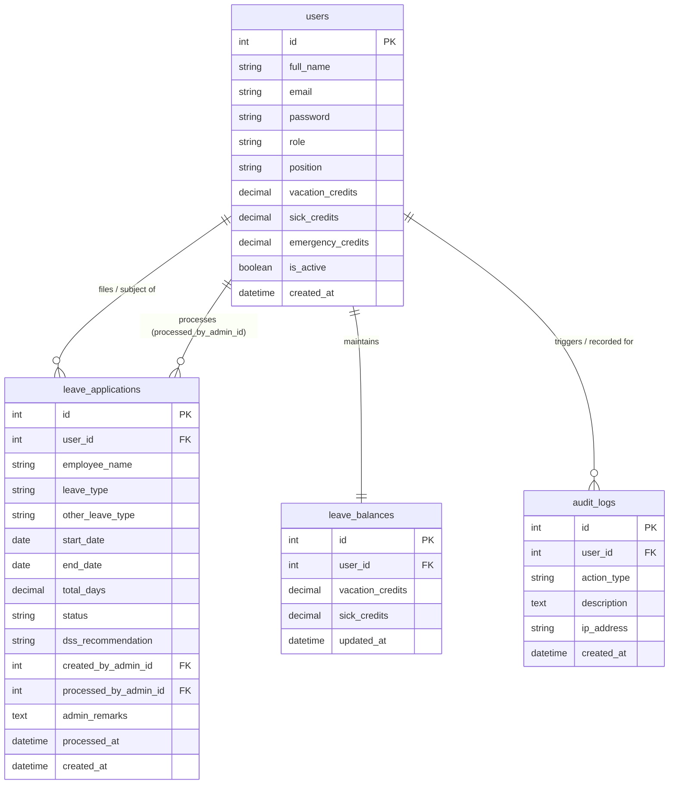

# Database Schema Audit & Supabase Migration Blueprint

This document details the reverse-engineered database schema extracted from MySQL data dictionaries (`.frm`, `.ibd`, `.TRG`, `db.opt`) and application queries, followed by a proposed Supabase PostgreSQL schema with Row-Level Security (RLS) policies and triggers.

---

## 1. Legacy MySQL Schema (`mho_db`)

Database Parameters:
- **Default Character Set**: `utf8mb4`
- **Default Collation**: `utf8mb4_unicode_ci`

### Table 1.1: `users`
Represents registered health office employees, administrators, and leadership.

| Column | Type | Nullable | Default | Description / Usage |
| :--- | :--- | :--- | :--- | :--- |
| `id` | `INT AUTO_INCREMENT` | `NO` | Primary Key | Unique user record identifier. |
| `username` | `VARCHAR(100)` | `YES` | `NULL` | Optional unique username for login authentication. |
| `email` | `VARCHAR(191)` | `NO` | Unique | User email address used for sign-in and notifications. |
| `password` | `VARCHAR(255)` | `NO` | None | Bcrypt hashed credential. |
| `full_name` | `VARCHAR(191)` | `NO` | None | Formal full name (e.g., "Maria Santos"). |
| `role` | `VARCHAR(50)` | `NO` | `'STAFF'` | System role: `'STAFF'`, `'MHO_ADMIN'`, `'MHO_HEAD'`. |
| `position` | `VARCHAR(100)` | `YES` | `NULL` | Job designation (e.g., "Staff Nurse II", "Rural Health Physician"). |
| `vacation_credits`| `DECIMAL(5,2)` | `YES` | `15.00` | Baseline allocated vacation credits. |
| `sick_credits` | `DECIMAL(5,2)` | `YES` | `15.00` | Baseline allocated sick credits. |
| `emergency_credits`| `DECIMAL(5,2)`| `YES` | `5.00` | Baseline allocated emergency credits. |
| `is_active` | `TINYINT(1)` | `NO` | `1` | Account state flag (`1` = active, `0` = deactivated). |
| `created_at` | `DATETIME / TIMESTAMP` | `YES` | `CURRENT_TIMESTAMP` | Account registration timestamp. |

---

### Table 1.2: `leave_applications`
Primary transactional table storing employee leave requests, workflow state, and DSS audit notes.

| Column | Type | Nullable | Default | Description / Usage |
| :--- | :--- | :--- | :--- | :--- |
| `id` | `INT AUTO_INCREMENT` | `NO` | Primary Key | Unique leave application reference number. |
| `user_id` | `INT` | `YES` | `NULL` | Foreign key referencing `users.id`. Nullable for walk-in employees without portal accounts. |
| `employee_name` | `VARCHAR(191)` | `YES` | `NULL` | Captured full name for walk-in filings or denormalized display. |
| `leave_type` | `VARCHAR(100)` | `NO` | None | Category: `'Vacation Leave'`, `'Sick Leave'`, `'Emergency Leave'`, `'Maternity Leave'`, `'Paternity Leave'`, `'Special Privilege Leave'`, `'Other'`. |
| `other_leave_type`| `VARCHAR(191)` | `YES` | `NULL` | Custom specification when `leave_type` is `'Other'`. |
| `start_date` | `DATE` | `NO` | None | First day of requested leave period. |
| `end_date` | `DATE` | `NO` | None | Final day of requested leave period. |
| `total_days` | `DECIMAL(4,1)` / `INT` | `NO` | None | Total duration in working days (excluding weekends). |
| `reason` | `TEXT` | `YES` | `NULL` | Justification / applicant remarks. |
| `status` | `VARCHAR(50)` | `NO` | `'PENDING'` | Application workflow status: `'PENDING'`, `'APPROVED'`, `'REJECTED'`. |
| `dss_recommendation` | `VARCHAR(100)` | `YES` | `'RECOMMENDED (PENDING REVIEW)'` | Cached DSS engine decision tag. |
| `created_by_admin_id` | `INT` | `YES` | `NULL` | Administrator ID who filed on behalf of employee (if applicable). |
| `processed_by_admin_id` | `INT` | `YES` | `NULL` | Foreign key referencing `users.id` for the approving/rejecting administrator. |
| `admin_remarks` | `TEXT` | `YES` | `NULL` | Notes/justification written by reviewer during decision. |
| `processed_at` | `DATETIME` | `YES` | `NULL` | Timestamp when status transitioned out of `'PENDING'`. |
| `created_at` | `DATETIME / TIMESTAMP` | `YES` | `CURRENT_TIMESTAMP` | Date and time the request was originally submitted. |

---

### Table 1.3: `leave_balances`
Dedicated ledger tracking remaining leave credits per registered personnel.

| Column | Type | Nullable | Default | Description / Usage |
| :--- | :--- | :--- | :--- | :--- |
| `id` | `INT AUTO_INCREMENT` | `NO` | Primary Key | Primary key for balance entry. |
| `user_id` | `INT` | `NO` | None | Unique Foreign Key referencing `users.id`. |
| `vacation_credits`| `DECIMAL(6,2)` | `NO` | `15.00` | Net remaining vacation days available for use. |
| `sick_credits` | `DECIMAL(6,2)` | `NO` | `15.00` | Net remaining sick leave days available for use. |
| `updated_at` | `TIMESTAMP` | `YES` | `CURRENT_TIMESTAMP ON UPDATE CURRENT_TIMESTAMP` | Timestamp of last credit deduction or top-up. |

---

### Table 1.4: `audit_logs`
Chronological transaction and operational audit log.

| Column | Type | Nullable | Default | Description / Usage |
| :--- | :--- | :--- | :--- | :--- |
| `id` | `INT AUTO_INCREMENT` | `NO` | Primary Key | Unique log entry sequence number. |
| `user_id` | `INT` | `YES` | `NULL` | User ID of the actor or subject of the logged event. |
| `action_type` / `action` | `VARCHAR(100)` | `NO` | None | Standard event tag (e.g. `'LEAVE_APPROVED'`, `'LEAVE_REJECTED'`). |
| `description` / `details`| `TEXT` | `NO` | None | Narrative describing changes made, remarks, and employee affected. |
| `ip_address` | `VARCHAR(45)` | `YES` | `'127.0.0.1'` | Client IP address at event dispatch. |
| `created_at` | `TIMESTAMP` | `NO` | `CURRENT_TIMESTAMP` | Precise timestamp of transaction occurrence. |

---

## 2. Entity-Relationship Diagram (ERD)



---

## 3. Target PostgreSQL DDL for Supabase

The following schema maps the legacy MySQL architecture to modern Supabase PostgreSQL standards, tying authentication into `auth.users`, enabling Row-Level Security (RLS), and installing the audit logging trigger.

```sql
-- 1. Enable Required Extensions
CREATE EXTENSION IF NOT EXISTS "uuid-ossp";

-- 2. Custom Role Enum
CREATE TYPE user_role AS ENUM ('STAFF', 'MHO_ADMIN', 'MHO_HEAD');
CREATE TYPE leave_status AS ENUM ('PENDING', 'APPROVED', 'REJECTED');

-- 3. Profiles Table (Linked to Supabase Auth)
CREATE TABLE public.profiles (
    id UUID PRIMARY KEY REFERENCES auth.users(id) ON DELETE CASCADE,
    full_name TEXT NOT NULL,
    email TEXT UNIQUE NOT NULL,
    role user_role NOT NULL DEFAULT 'STAFF',
    position TEXT,
    vacation_credits NUMERIC(5,2) NOT NULL DEFAULT 15.00,
    sick_credits NUMERIC(5,2) NOT NULL DEFAULT 15.00,
    emergency_credits NUMERIC(5,2) NOT NULL DEFAULT 5.00,
    is_active BOOLEAN NOT NULL DEFAULT TRUE,
    created_at TIMESTAMPTZ NOT NULL DEFAULT timezone('utc'::text, now()),
    updated_at TIMESTAMPTZ NOT NULL DEFAULT timezone('utc'::text, now())
);

-- 4. Leave Applications Table
CREATE TABLE public.leave_applications (
    id BIGINT GENERATED ALWAYS AS IDENTITY PRIMARY KEY,
    user_id UUID REFERENCES public.profiles(id) ON DELETE SET NULL,
    employee_name TEXT,
    leave_type TEXT NOT NULL,
    other_leave_type TEXT,
    start_date DATE NOT NULL,
    end_date DATE NOT NULL,
    total_days NUMERIC(4,1) NOT NULL,
    reason TEXT,
    status leave_status NOT NULL DEFAULT 'PENDING',
    dss_recommendation TEXT DEFAULT 'RECOMMENDED (PENDING REVIEW)',
    created_by_admin_id UUID REFERENCES public.profiles(id) ON DELETE SET NULL,
    processed_by_admin_id UUID REFERENCES public.profiles(id) ON DELETE SET NULL,
    admin_remarks TEXT,
    processed_at TIMESTAMPTZ,
    created_at TIMESTAMPTZ NOT NULL DEFAULT timezone('utc'::text, now())
);

-- 5. Audit Logs Table
CREATE TABLE public.audit_logs (
    id BIGINT GENERATED ALWAYS AS IDENTITY PRIMARY KEY,
    user_id UUID REFERENCES public.profiles(id) ON DELETE SET NULL,
    action_type TEXT NOT NULL,
    description TEXT NOT NULL,
    ip_address TEXT DEFAULT '127.0.0.1',
    created_at TIMESTAMPTZ NOT NULL DEFAULT timezone('utc'::text, now())
);

-- 6. PostgreSQL Trigger Function: Audit Log on Status Transition
CREATE OR REPLACE FUNCTION public.handle_leave_status_audit()
RETURNS TRIGGER AS $$
BEGIN
    IF (OLD.status IS DISTINCT FROM NEW.status) THEN
        INSERT INTO public.audit_logs (user_id, action_type, description, ip_address)
        VALUES (
            NEW.user_id,
            CONCAT('LEAVE_', NEW.status::text),
            CONCAT('Leave Application #', NEW.id, ' (', NEW.leave_type, ' - ', NEW.total_days, ' days) status changed from ', OLD.status::text, ' to ', NEW.status::text, '.'),
            '127.0.0.1'
        );
    END IF;
    RETURN NEW;
END;
$$ LANGUAGE plpgsql SECURITY DEFINER;

CREATE TRIGGER trg_leave_status_update
AFTER UPDATE ON public.leave_applications
FOR EACH ROW EXECUTE FUNCTION public.handle_leave_status_audit();

-- 7. Row-Level Security (RLS) Policies
ALTER TABLE public.profiles ENABLE ROW LEVEL SECURITY;
ALTER TABLE public.leave_applications ENABLE ROW LEVEL SECURITY;
ALTER TABLE public.audit_logs ENABLE ROW LEVEL SECURITY;

-- Profiles: Users can view own profile; Admins/Head can view all
CREATE POLICY "Profiles view policy" ON public.profiles
FOR SELECT USING (
    auth.uid() = id OR 
    EXISTS (SELECT 1 FROM public.profiles WHERE id = auth.uid() AND role IN ('MHO_ADMIN', 'MHO_HEAD'))
);

-- Leave Applications: Staff view own; Admins/Head view all
CREATE POLICY "Leave applications select policy" ON public.leave_applications
FOR SELECT USING (
    auth.uid() = user_id OR 
    EXISTS (SELECT 1 FROM public.profiles WHERE id = auth.uid() AND role IN ('MHO_ADMIN', 'MHO_HEAD'))
);

-- Leave Applications: Staff can submit applications
CREATE POLICY "Leave applications insert policy" ON public.leave_applications
FOR INSERT WITH CHECK (
    auth.uid() = user_id OR 
    EXISTS (SELECT 1 FROM public.profiles WHERE id = auth.uid() AND role = 'MHO_ADMIN')
);

-- Leave Applications: Admins/Head can update status
CREATE POLICY "Leave applications update policy" ON public.leave_applications
FOR UPDATE USING (
    EXISTS (SELECT 1 FROM public.profiles WHERE id = auth.uid() AND role IN ('MHO_ADMIN', 'MHO_HEAD'))
);

-- Audit Logs: Viewable by Head only
CREATE POLICY "Audit logs select policy" ON public.audit_logs
FOR SELECT USING (
    EXISTS (SELECT 1 FROM public.profiles WHERE id = auth.uid() AND role = 'MHO_HEAD')
);
```
